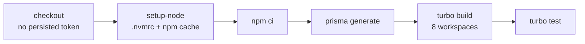

# GitHub Actions

## Workflows

| Workflow | File | Triggers | Purpose | Status |
|---|---|---|---|---|
| CI | [`.github/workflows/ci.yml`](../../.github/workflows/ci.yml) | PR → `main`, push to `main`, manual | Three jobs, listed below | M1.2, M1.3 |
| Deploy staging | [`.github/workflows/deploy-staging.yml`](../../.github/workflows/deploy-staging.yml) | manual only, from `main`, off until `STAGING_DEPLOY_ENABLED=true` | Helm deploy of an image digest to the `staging` environment | **Draft, never run, unverified** ([ADR-0005](../adr/0005-staging-cd.md), [setup](../runbooks/staging-deploy-setup.md)) |

e2e, migration, Docker and security jobs are added in later steps. The schedule is in [implementation-plan.md §4](../history/buildpipe/implementation-plan.md).

## CI jobs

Each job is its own check on the PR. The check name is the job `name:`, with no workflow prefix.

| Check name (use this in rulesets) | Job id | Runs | Fails when |
|---|---|---|---|
| `Build and test` | `build-test` | `npm ci`, `prisma generate`, build, **typecheck**, unit tests, **e2e smoke tests** | Any step fails. Typecheck also covers `*.spec.ts`, which the build skips |
| `Static checks` | `static-checks` | `npm ci`, ESLint (`npm run lint`), Prettier (`npm run format:check`) | A lint error or an unformatted file |
| `Migrations` | `migrations` | PostgreSQL 16 service container: `prisma migrate deploy` on an empty DB, `prisma migrate diff --exit-code` drift check, `npm run test:db` (service-request repository and service against the real database), seed twice. **Not yet a required check:** add `Migrations` to ruleset `protect-main` | A migration fails to apply, `schema.prisma` has changes without a migration, or the seed breaks |
| `Workflow lint` | `workflow-lint` | actionlint v1.7.12 (`go run …@v1.7.12`; Go is preinstalled on the runner image (confirmed); shellcheck availability is not yet confirmed from the logs) | A workflow syntax, expression or shell-script problem |

### `build-test` in detail



| Step | Command | Fails the run when |
|---|---|---|
| Install | `npm ci --no-audit --no-fund` | `package-lock.json` is missing or out of sync with any `package.json` |
| Prisma | `npx --no-install prisma generate` | The schema is invalid. `--no-install` forbids fetching an unpinned Prisma |
| Build | `npm run build` → `turbo run build` | Any workspace fails to compile |
| Typecheck | `npm run typecheck` → per-workspace `tsc --noEmit --incremental false` | A type error anywhere, including specs. `--incremental false` keeps it from writing `tsbuildinfo`, which would make a later build skip emitting |
| Test | `npm test` → `turbo run test` | Any jest suite fails or does not compile |

Run the same thing locally:

```bash
npm ci && npx --no-install prisma generate && npm run build && npm run typecheck && npm test && npm run test:e2e
npm run lint && npm run format:check   # Static checks
```

Fix formatting with `npm run format`.

## Security conventions (apply to every workflow)

- **Pinned actions.** Every `uses:` references a full 40-character commit SHA with the release tag in a comment. Tags can be re-pointed, which is what happened in the tj-actions/changed-files compromise. Update pins deliberately: resolve the new tag's SHA with `gh api repos/<owner>/<repo>/commits/<tag> --jq .sha`.
- **Least-privilege token.** The workflow-level `permissions: contents: read`. Jobs that need more (for example `packages: write` for GHCR) declare it on the job only.
- **No persisted credentials.** `actions/checkout` uses `persist-credentials: false`, so later steps such as `npm ci` lifecycle scripts can't read the token from `.git/config`.
- **No `pull_request_target`.** Fork PRs run with a read-only token and no secrets.
- **Concurrency.** A new push to a PR cancels that PR's previous run. Runs on `main` are never cancelled.
- **Telemetry off.** Turbo (`TURBO_TELEMETRY_DISABLED`) and Prisma (`CHECKPOINT_DISABLE`) phone-home is disabled.

## Toolchain

- Node version comes from `.nvmrc` (24). The runner image is pinned to `ubuntu-24.04` instead of `ubuntu-latest`, so image upgrades are deliberate.
- `packageManager` declares `npm@11.16.0`. npm itself does not enforce this field. The runner uses whatever npm ships with the resolved Node 24 release, and the "Toolchain versions" step prints both versions in every run.

## Validating workflow changes locally

```bash
go run github.com/rhysd/actionlint/cmd/actionlint@v1.7.12 .github/workflows/*.yml
```

actionlint runs shellcheck on `run:` blocks only when `shellcheck` is installed.

## Required checks

Enforced since 2026-10-23 by the repository ruleset `protect-main` on the default branch: pull request required (0 approvals), branches must be up to date, and the checks `Build and test`, `Static checks` and `Workflow lint` must pass. Force pushes and deletion are blocked and there are no bypass actors. **When a job is added to `ci.yml`, its `name:` must be added to the ruleset by the repo owner** (Settings → Rules → Rulesets), or it will not gate merges.

## End-to-end smoke tests

`npm run test:e2e` runs `apps/api/test/api.e2e-spec.ts` (config: `apps/api/test/jest-e2e.json`).

- Boots the **real `AppModule`** and the same HTTP setup as production (`configureApp()` in `apps/api/src/app.setup.ts`: helmet, validation pipe, Swagger), then drives it with Supertest.
- **Stubbed:** Prisma, the BullMQ queue service and NATS events, so no database, Redis or NATS is needed in CI. `@kubernetes/client-node` is replaced by an empty module because v1 is ESM-only and Jest runs CommonJS.
- **Covers:** `/health`, security headers, the OpenAPI document, 401 for anonymous/malformed/forged/deleted-user tokens on protected routes (including the MCP bridge), 403 role checks (viewer/operator vs admin), request validation (empty body, unknown properties).
- **Regression guard (S11):** registration tests assert that a payload with `role` is rejected (400, no user created) and that a new account is a `viewer` who is denied admin routes.
- **Not covered:** real database behaviour, Redis/BullMQ, NATS, Kubernetes. Those need the integration suites planned for M3 and later.
- Test-only environment values live in `apps/api/test/setup-env.ts` (`NODE_ENV=production` to avoid the pino-pretty worker, `LOG_LEVEL=silent`, throwaway secrets).
